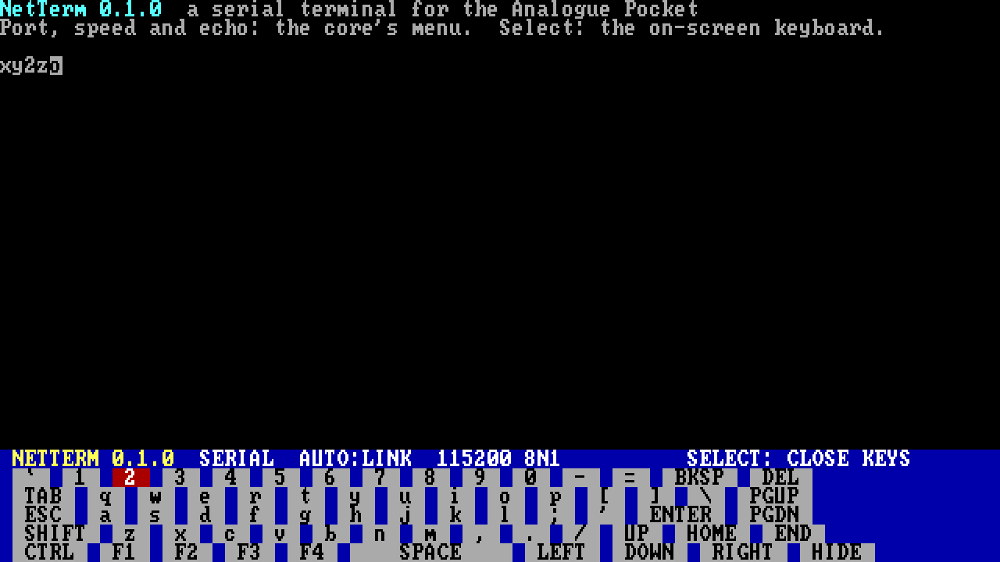

# NetTerm for the Analogue Pocket

A **serial terminal** core: ANSI / VT100 on an 80 x 24 screen, over a 3.3 V
serial line on the **link port** or the **cartridge slot**. Type on a USB
keyboard in the Dock, or on the **on-screen keyboard** with the Pocket's own
buttons.

*(From the simulation: the banner, keys typed on a Dock keyboard and echoed
back through a serial loopback, and the on-screen keyboard open.)*

**Status: 0.1.4, milestone 1** (docs/DESIGN.md). Works on a Pocket: the
screen, the Dock keyboard, the on-screen keyboard, the menu, local echo, and
the serial line on the link port, both ways, with a PC terminal (pySerial's
miniterm) through a 3.3 V USB-serial adapter (2026-11-21). The cartridge
slot's serial line is not yet tried.

## What it talks to

Anything with a **3.3 V TTL serial** line (8N1, 300 to 921,600 baud, no flow
control):
- a USB-serial adapter (3.3 V) to a computer, for a shell or a BBS client;
- a WiFi modem (an ESP8266 / ESP32 running Zimodem or similar): `ATDT
  host:port` dials a Telnet BBS;
- a Raspberry Pi's or a router's serial console.

Real RS-232 (+-12 V) needs a level shifter (a MAX3232 board) in between.
For a **5 V TTL** device, put a level shifter on its TX line too: what voltage
the Pocket's ports tolerate isn't documented.

**Wiring** (the device's TX to the Pocket's RX, and the reverse; ground to
ground; leave the power pins unconnected):

| Port | Pocket TX (to the device's RX) | Pocket RX (from the device's TX) | Ground |
|---|---|---|---|
| Link port | SO, pin 2 | SI, pin 3 | pin 6 |
| Cartridge slot | pin 5 (GBA /CS) | pin 31 (GBA /REQ) | pin 32 |

The link port is the easy one undocked (a cut link cable); in the Dock the
link port is covered, so use the cartridge slot (a breakout cartridge, or the
FujiNet Pocket cartridge, `fujinet-hardware-analogue-pocket`).

## Install

1. Download the latest development build:
   <https://github.com/Miasmark/openfpga-netterm/releases/tag/dev>.
2. Unzip it and copy `Cores` and `Platforms` to the root of the SD card.
3. Run **NetTerm** from the openFPGA cores list. Nothing has to be loaded.

## Using it

**The menu** (the core's settings, kept between sessions):

| Setting | Values |
|---|---|
| Port | Auto (the line that last started a byte), Link port, Cartridge; Loopback test (TX straight back to RX inside the core: no wires) |
| Speed | 300 to 921,600 baud (115,200 by default) |
| Local Echo | Off / On: what you type shows as typed (Enter starts a new line, Backspace erases) |
| Enter Sends | CR / CR LF / LF |
| Backspace Sends | DEL (127) / BS (8) |
| Reset | restarts the terminal |

**A USB keyboard in the Dock:** a US layout; Shift, Ctrl; the arrows, Home,
End, Page Up / Down, Insert, Delete and F1-F12 send VT100 / xterm sequences.
Keys repeat after half a second.

**The Pocket's buttons** (or a controller in the Dock, as player 1):

| | On-screen keyboard closed | Open |
|---|---|---|
| D-pad | the arrow keys | move |
| A | Enter | type the key |
| B | Backspace | Backspace |
| Y | Space | Space |
| X | Esc | Shift, once |
| L | Tab | Ctrl, once |
| R | | Shift lock |
| Select | open | close |

**The screen:** rows 1-24 are the terminal; row 25 is the status line (port,
speed, echo); rows 26-30 hold the on-screen keyboard.

**The line check** (0.1.2, the bottom row while the on-screen keyboard is
closed): `T` bytes handed to the port, `X` bytes the transmitter started, `R` bytes received, `S` start bits seen, `F` bytes
dropped for a bad stop bit (a speed mismatch), all hex; then `L` and `C`, the
levels of the link port's SI and the cartridge's pin 31 (1 = high, a line at
rest). A loopback (SO joined to SI) should count T, R and S up together.

**The terminal:** VT100 / ANSI-BBS: cursor moves, erases, insert / delete,
scroll regions, 16 colours (SGR), saved cursor, and the replies to "where is
the cursor" (ESC [6n) and "what are you" (ESC [c) that BBSs ask. Characters
are code page 437, so BBS line and block art draws.

## Build

GitHub Actions builds every push:
1. `firmware/build.sh`: the firmware (clang and lld, RV32IM), into
   `src/fpga/core/firmware.hex`, the CPU's RAM image;
2. `tools/gen_pll.sh`: the PLL, in the `raetro/quartus:21.1` image;
3. Quartus compiles the core;
4. `tools/package.sh`: the SD card zip, published as the `dev` pre-release.

**Simulation:** `sim/run.sh` (Verilator 5, clang / lld, Python's PIL) runs the
whole core, CPU and firmware included, and writes `sim/work/frame.png`.

## Files

| Path | What |
|---|---|
| `docs/DESIGN.md` | How it works, and the milestones. |
| `src/fpga/core/nt_soc.sv` | The system: CPU, RAM, screen RAM, MMIO, the controllers' crossing. |
| `src/fpga/core/nt_uart.sv`, `nt_video.sv` | The serial port; the text video. |
| `src/fpga/core/core_top.v` | The APF top level: pins, PLL, settings, reset. |
| `firmware/` | The C firmware: `term.c` the terminal, `keys.c` the keyboards, `main.c` the loop. |
| `tools/gen_font.py` | The code page 437 font, from font8x8. |
| `dist/` | The core's JSON files and platform. |

## License

MIT for this project's own files (`LICENSE`); PicoRV32 is ISC, the font
public domain, Analogue's framework files under the APF license
(`THIRD_PARTY_NOTICES.md`).
